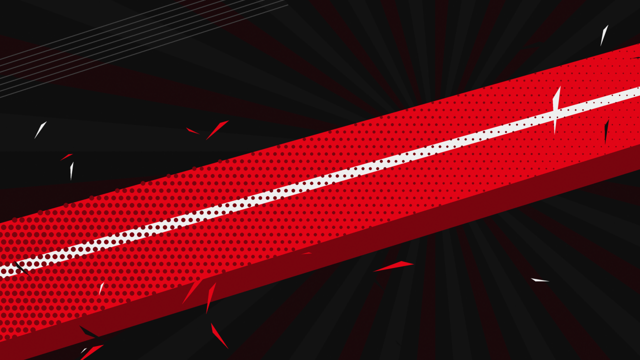

# persona-rice

A red / black / white, punk-collage Linux rice inspired by the *Persona* series look: ransom-note lettering, starbursts, torn edges, glitch flickers and zero rounded corners.

Built on **Hyprland + [Caelestia shell](https://github.com/caelestia-dots/shell) + Quickshell**. The terminal greeting works on its own on any distro.

> Fan-made and unofficial. Not affiliated with or endorsed by Atlus or SEGA. Every graphic here is original and drawn in code. It contains no game assets.

| Terminal greeting | Wallpapers |
|---|---|
|  |   |

## What's inside

| Part | Where it goes | What it does |
|---|---|---|
| `fastfetch/persona.py` | `~/.config/fastfetch/` | Animated half-block greeting: spinning starburst, white mask with glinting eyes, glitch intro. System info sits on the right. |
| `fastfetch/persona.jsonc` | `~/.config/fastfetch/` | Red/white fastfetch layout used by the greeting |
| `fish/conf.d/persona-greeting.fish` | `~/.config/fish/conf.d/` | Runs the greeting. It stops animating as soon as you run a command or the screen scrolls, and pauses while the window is unfocused. |
| `quickshell/persona-bar/` | `~/.config/quickshell/` | Top bar with ransom-note workspace tiles, starburst stickers and a torn edge. Its colours come live from Caelestia's scheme. |
| `quickshell/caelestia-overlay/`, `caelestia-patches.py`, `sync-caelestia.sh` | `~/.config/quickshell/` | Builds a patched user copy of Caelestia with a punk lock screen and notification cards. Your system package is never touched. |
| `caelestia/` | `~/.config/caelestia/` | `persona` colour scheme, zero-rounding tokens, Bebas Neue / Antonio fonts |
| `hypr/persona-look.{conf,lua}` | `~/.config/hypr/` | Red/white borders, red glow shadows, no rounding, autostart lines |
| `wallpapers/` | `~/Pictures/Wallpapers/` | Two 4K wallpapers |

## Requirements

Arch / CachyOS package names (AUR marked):

```
hyprland quickshell fastfetch fish python
caelestia-shell caelestia-cli                    # AUR
ttf-antonio otf-bebas-neue-git                   # AUR
ttf-material-symbols-variable-git                # AUR
noto-fonts ttf-jetbrains-mono-nerd
```

The greeting needs a truecolor terminal (kitty, foot, wezterm, alacritty...) at least ~90 columns wide. Narrower windows get the plain info only.

## Install

```sh
git clone https://github.com/adixno/persona-rice
cd persona-rice
./install.sh              # everything
./install.sh --greeting   # just the terminal greeting
```

The installer backs up every file it replaces to `~/.local/share/persona-rice/backup-<date>/`. It does **not** edit your Hyprland config. Add the look yourself:

- `hyprland.conf`: copy `hypr/persona-look.conf` to `~/.config/hypr/` and add `source = ~/.config/hypr/persona-look.conf`
- Lua config: copy `hypr/persona-look.lua` and load it after your own decorations

If you start Caelestia some other way, remove the autostart lines from that file.

Optional: put a square picture at `~/.face` for the lock screen avatar.

## After a Caelestia update

The patched shell is a copy, so refresh it after `caelestia-shell` updates:

```sh
~/.config/quickshell/sync-caelestia.sh
caelestia shell -k && caelestia shell -d
```

If an upstream change breaks a patch, the script stops and names the file and anchor that failed. Your working copy stays as it was, and the previous build is kept as `caelestia.prev`.

If changing the wallpaper resets the colours, run `python3 ~/.config/caelestia/persona-scheme.py`.

## Tweaks

- **Preview the greeting** without opening a terminal: `python3 ~/.config/fastfetch/persona.py --still`
- **Colours:** `RED`, `BLK`, `WHT` at the top of `persona.py`, and `persona-dark.txt` / `persona-scheme.py` for the shell
- **Bar height:** `barHeight` in `persona-bar/shell.qml` *and* `bar_height` in `sync-caelestia.sh`. Keep them equal.
- **Fractional scaling:** slanted shapes use `Shape.CurveRenderer` (`components/punk/Slab.qml`). Rotated rectangles look jagged at 1.5x.

## Uninstall

Restore files from the backup folder. Also delete `~/.config/quickshell/{persona-bar,caelestia,caelestia-overlay}` and `~/.config/fish/conf.d/persona-greeting.fish`, then run `caelestia shell -k && caelestia shell -d`.

## License

MIT
