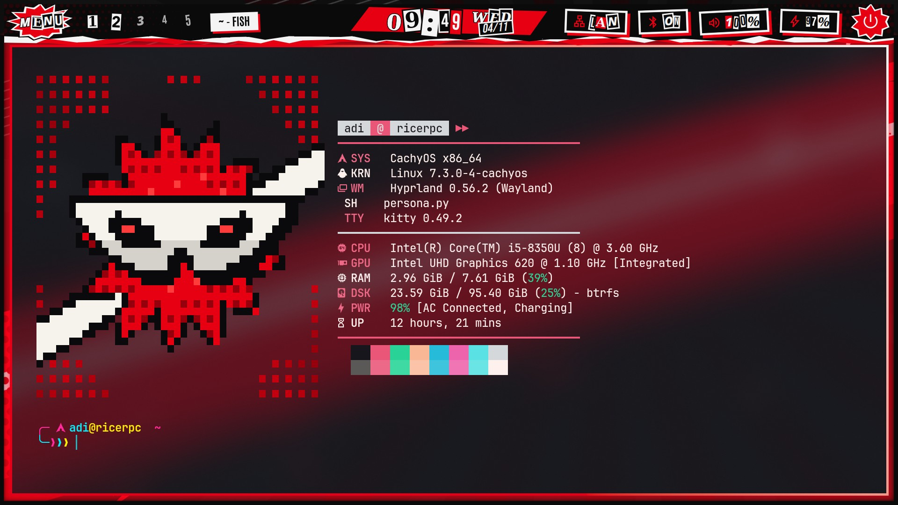
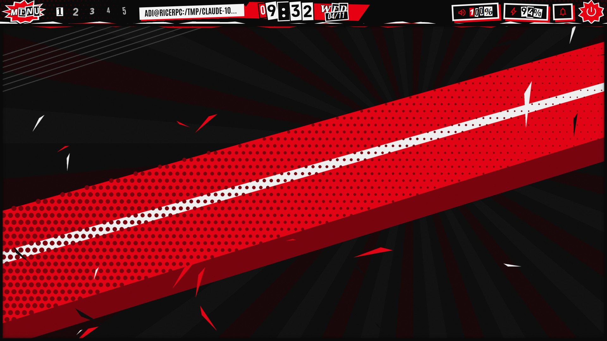
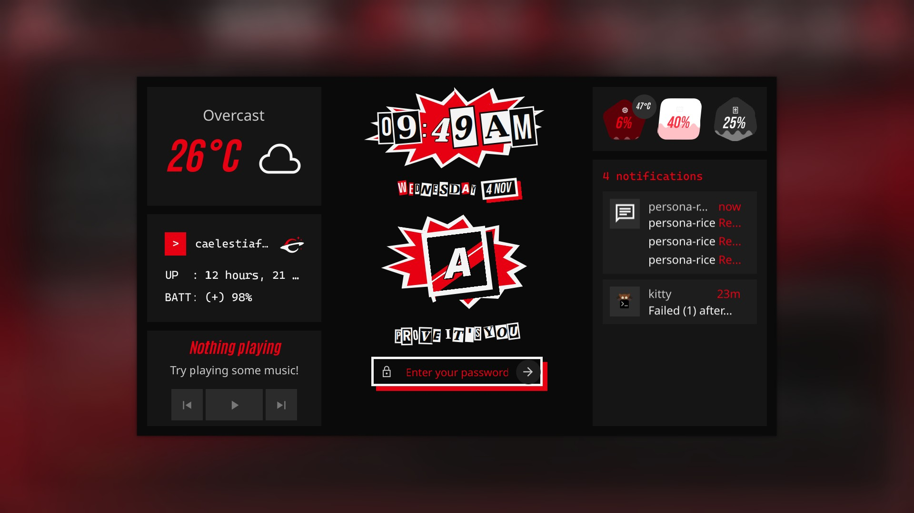
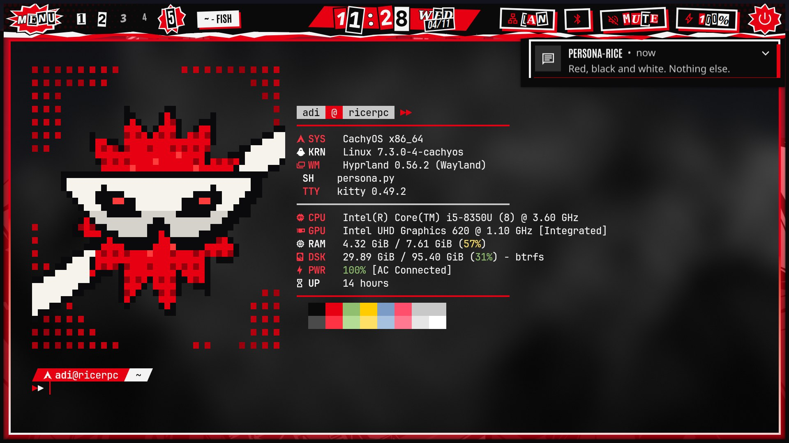
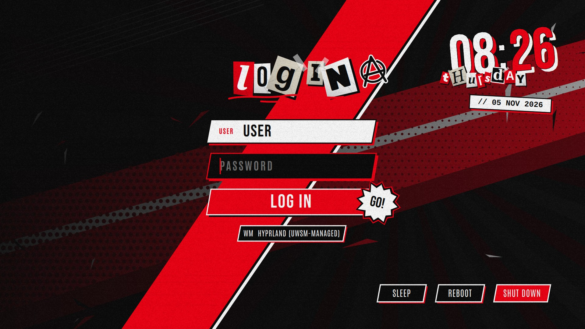

# persona-rice

A red / black / white, punk-collage Linux rice inspired by the *Persona* series look: ransom-note lettering, starbursts, torn edges, glitch flickers and zero rounded corners.

Built on **Hyprland + [Caelestia shell](https://github.com/caelestia-dots/shell) + Quickshell**. The terminal greeting works on its own on any distro.

> Fan-made and unofficial. Not affiliated with or endorsed by Atlus or SEGA. Every graphic here is original and drawn in code. It contains no game assets. (The album art in the lock screen screenshot is just whatever Spotify was playing; it isn't part of the rice.)



| Desktop + bar | Lock screen |
|---|---|
|  |  |
| **Notifications** | **Wallpapers** |
|  |   |



## What's inside

The rice is split into **themes** you can switch between with one command, plus a few shared pieces.

```
themes/<id>/
  theme.sh          name, description, Caelestia scheme name, default wallpaper
  terminal/         greeting.py, fastfetch.jsonc, colors.fish, starship.toml, kitty.conf
  caelestia/        scheme.txt, scheme.py, shell.json (fonts etc.), shell-tokens.json (rounding)
  quickshell/       persona-bar/, caelestia-overlay/, caelestia-patches.py
  hypr/             look.lua, look.conf (borders, shadows, gaps)
  sddm/             login screen theme
  wallpapers/
shared/             persona-theme (the switcher), sync-caelestia.sh, fish greeting hook, hypr autostart
```

| Theme | Look |
|---|---|
| `p5` Persona 5 | Red / black / white punk collage: ransom-note lettering, starbursts, torn edges, glitch flickers, zero rounding |

What a theme controls:

| Part | Installed to | What it does (p5) |
|---|---|---|
| `terminal/greeting.py`, `fastfetch.jsonc` | `~/.config/fastfetch/persona.{py,jsonc}` | Animated half-block greeting: spinning starburst, white mask with glinting eyes, glitch intro, system info on the right. It stops animating as soon as you run a command, and pauses while the window is unfocused. |
| `terminal/colors.fish` | `~/.config/fish/conf.d/persona-colors.fish` | Fish syntax colours and a sharp red fzf theme |
| `terminal/starship.toml` | `~/.config/starship.toml` | Prompt: user on a slanted red label, folder on a white one, `▶▶` input line |
| `terminal/kitty.conf` | `~/.config/kitty/themes/persona.conf` | Terminal palette. The installer adds one `include` line to `kitty.conf`. |
| `quickshell/persona-bar/` | `~/.config/quickshell/persona-bar/` | Top bar with ransom-note workspace tiles, starburst stickers and a torn edge, plus Wi-Fi, Bluetooth, volume and battery buttons. Colours come live from Caelestia's scheme. |
| `quickshell/caelestia-overlay/`, `caelestia-patches.py` | `~/.config/quickshell/` | Builds a patched user copy of Caelestia with a punk lock screen and notification cards. Your system package is never touched. |
| `caelestia/` | `~/.config/caelestia/` | Colour scheme, rounding tokens, fonts |
| `hypr/look.lua` / `look.conf` | `~/.config/hypr/config/persona_theme.lua` / `~/.config/hypr/persona-theme.conf` | Window borders, glow shadows, rounding |
| `sddm/` | `/usr/share/sddm/themes/persona-<id>` | Login screen (optional, see below) |
| `wallpapers/` | `~/Pictures/Wallpapers/` | Wallpapers |

## Requirements

Arch / CachyOS package names (AUR marked):

```
hyprland quickshell fastfetch fish python
starship kitty                                   # prompt + terminal palette (optional)
caelestia-shell caelestia-cli                    # AUR
ttf-antonio otf-bebas-neue-git                   # AUR
ttf-material-symbols-variable-git                # AUR
noto-fonts ttf-jetbrains-mono-nerd
networkmanager bluez pavucontrol                 # Wi-Fi/Bluetooth buttons, volume right-click
```

Tested with Hyprland 0.56, Quickshell 0.3.2, caelestia-shell 2.5.0 and caelestia-cli 1.1.3. The Caelestia patches are tied to that version. If yours differs and a patch doesn't fit, the installer says so and Caelestia runs unpatched (stock lock screen and notifications). The bar, colours and greeting still work.

The greeting needs a truecolor terminal (kitty, foot, wezterm, alacritty...) at least ~90 columns wide. Narrower windows get the plain info only.

## Install

```sh
git clone https://github.com/adixno/persona-rice
cd persona-rice
./install.sh              # everything, Persona 5 theme
./install.sh --terminal   # just the terminal: greeting, prompt, colours
```

The first run backs up every file a theme will replace to `~/.local/share/persona-rice/backup-<date>/`. It copies the themes to `~/.local/share/persona-rice/themes/`, installs the `persona-theme` command to `~/.local/bin`, then applies the theme.

Two things it changes in your Hyprland config:

- **Lua config:** appends `require("config.persona_theme")` to `hyprland.lua` (backup saved as `hyprland.lua.bak-persona-theme`). Keep it last so the theme look wins.
- **`hyprland.conf`:** it only tells you to add `source = ~/.config/hypr/persona-theme.conf` at the end.

Autostart isn't part of a theme. If Caelestia and the bar aren't started already, add `shared/hypr/autostart.lua` (or `autostart.conf`) to your config.

Optional: put a square picture at `~/.face` for the lock screen avatar.

## Switching themes

```sh
persona-theme          # list themes, * marks the active one
persona-theme p5       # apply one
persona-theme p5 --terminal   # only the terminal parts
```

A switch swaps the terminal files, Caelestia's scheme, fonts and rounding, the bar, the patched lock screen, the Hyprland look and the wallpaper. Then it restarts the shells and, if set up, changes the login screen. Each theme remembers the wallpaper you last used with it, so switching back restores that wallpaper instead of the theme default.

Files a theme owns are overwritten on every switch. Make lasting edits in `themes/<id>/` and re-run `./install.sh`, not in `~/.config`.

To add a theme, copy `themes/p5` to `themes/<new-id>`, edit `theme.sh` and the files, and re-run `./install.sh <new-id>`. Any part a theme leaves out stays as it was.

## After a Caelestia update

The patched shell is a copy, so refresh it after `caelestia-shell` updates:

```sh
~/.config/quickshell/sync-caelestia.sh
caelestia shell -k && caelestia shell -d
```

If an upstream change breaks a patch, the script stops and names the file and anchor that failed. Your working copy stays as it was, and the previous build is kept as `caelestia.prev`.

If changing the wallpaper resets the colours, run `python3 ~/.config/caelestia/persona-scheme.py` (or `persona-theme <id>` again).

## Bar buttons

| Button | Left click | Right click | Scroll |
|---|---|---|---|
| Network | Network settings | Wi-Fi on/off | |
| Bluetooth | Bluetooth settings | Bluetooth on/off | |
| Volume | Mute | pavucontrol | Volume |
| Clock | Dashboard | | |
| Power | Session menu | | |

The network button needs NetworkManager and is hidden without it. For notifications, bind a key to `caelestia shell drawers toggle sidebar`.

## Tweaks

Edit the files under `themes/<id>/`, then re-run `./install.sh <id>`.

- **Preview the greeting** without opening a terminal: `python3 ~/.config/fastfetch/persona.py --still`
- **Colours (p5):** `RED`, `BLK`, `WHT` at the top of `terminal/greeting.py`, `caelestia/scheme.txt` / `scheme.py` for the shell, and `[palettes.persona]` in `terminal/starship.toml` for the prompt
- **Bar height:** `barHeight` in `quickshell/persona-bar/shell.qml`. `sync-caelestia.sh` reads it from there.
- **Fractional scaling:** slanted shapes use `Shape.CurveRenderer` (`components/punk/Slab.qml`). Rotated rectangles look jagged at 1.5x.

## Login screen (SDDM)

Optional, and separate from `install.sh` because it needs root:

```sh
sudo ./sddm-install.sh            # install sddm + every theme's login screen; your login manager is untouched
sddm-greeter-qt6 --test-mode --theme /usr/share/sddm/themes/persona-p5   # preview one in a window
sudo ./sddm-install.sh --enable   # switch from greetd to sddm (takes effect next boot)
sudo ./sddm-install.sh --revert   # back to greetd
```

Each theme's login screen is installed as `persona-<id>`. `persona-theme` switches it along with everything else. For that, the script installs a small root-owned helper (`/usr/local/bin/persona-sddm-theme`) plus a sudoers rule letting your user run only that helper. The helper accepts nothing but an installed `persona-*` theme name.

The background is the theme's default wallpaper unless you put your own picture at `themes/<id>/sddm/background.png` before installing (it's gitignored). Colours are in `themes/<id>/sddm/theme.conf`. Re-run `sudo ./sddm-install.sh` after editing.

If your Caelestia autostart sets `CAELESTIA_LOCK_ON_START=1`, drop it, or you'll get the lock screen right after logging in.

## Uninstall

Restore files from the backup folder. Also delete `~/.local/share/persona-rice`, `~/.local/state/persona-theme`, `~/.local/bin/persona-theme`, `~/.config/quickshell/{persona-bar,caelestia,caelestia-overlay}`, `~/.config/fish/conf.d/persona-{greeting,colors}.fish`, `~/.config/kitty/themes/persona.conf` (plus its `include` line in `kitty.conf`) and the `persona_theme` line in `hyprland.lua`. Then run `caelestia shell -k && caelestia shell -d`. For the login screen: `sudo ./sddm-install.sh --revert`, then remove `/usr/share/sddm/themes/persona-*`, `/usr/local/bin/persona-sddm-theme`, `/etc/sudoers.d/persona-sddm-theme` and `/etc/sddm.conf.d/persona.conf`.

## License

MIT
